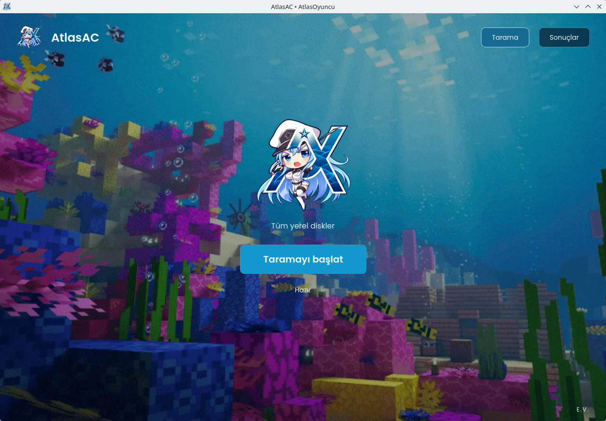

# AtlasAC 0.3.8

[Windows EXE indir](https://github.com/ZeninKaanX/AtlasAC/releases/latest/download/AtlasAC.exe) · [Linux x64 indir](https://github.com/ZeninKaanX/AtlasAC/releases/latest/download/AtlasAC-Linux-x64) · [Tüm sürümler](https://github.com/ZeninKaanX/AtlasAC/releases)


AtlasOyuncu temalı, Windows ve Linux için **yerel masaüstü dosya ve sistem kaydı inceleme aracı**. Hesap, key, PIN, web sitesi, tarayıcı veya kurulum sihirbazı gerekmez. Qt Widgets kullanır; HTML/WebView içermez ve yerel HTTP sunucusu açmaz.

## Kullanım

1. Windows’ta `dist/AtlasAC.exe`, Linux’ta `dist/AtlasAC-Linux-x64` dosyasını aç. **Tek dosyadır; kurulum veya yanında `_internal` klasörü gerekmez.**
2. **Taramayı başlat** düğmesine bas. TrueFormTech iletişim bilgileri, kapsam ve saklama bilgilerini oku; cihazı incelemeye yetkiliysen ayrı teknik izin seçimini işaretle. Tüm yerel diskler otomatik seçilir.
3. Dosyalar ve eşleşmeler tarama sırasında canlı görünür; **Sonuçlar** sayfasına hemen geçebilirsin. Bitişte sesli sonuç animasyonu açılır; **Sonuçlar** düğmesine basana kadar ekranda kalır. İstersen JSON raporu kaydet.

İlk açılışta gömülü çalışma dosyaları geçici klasöre hazırlanırken kısa bir bekleme olabilir. Hazır uygulama Python veya pip kurulumu ve yönetici yetkisi istemez. Windows’ta korumalı Prefetch/USN/BAM kayıtları için isteğe bağlı “Yönetici olarak çalıştır” kullanılabilir; normal çalıştırmada erişim eksikleri gösterilir. Linux’ta indirilmiş dosyanın çalıştırma izni korunmamışsa dosya özelliklerinden çalıştırılabilir yap.

ZIP/TAR.GZ arşivleri aynı tek dosyalık uygulamayı içerir. Linux derlemeleri glibc 2.44 üzerinde üretildi; eski dağıtımlarda doğrulanmadı. SHA-256 değerleri `dist/SHA256SUMS.txt` içindedir. Derlemeler imzasızdır.

Son 50 tarama, en fazla 7 gün `~/.atlasac/reports` altında maskelenmiş JSON olarak saklanır. Yaş kontrolü uygulama açılırken ve tarama başlarken yapılır; uygulama kapalıyken silme görevi çalışmaz. Dosya indeksi de 7 günlük son görülme süresiyle temizlenir. Sonuçlar sayfasındaki **Yerel verileri sil** rapor/indeks/işlem günlüğünü siler; dışa aktarılan kopyaları kapsamaz. Linux izinleri 700/600, Windows DACL mevcut kullanıcı ve SYSTEM ile sınırlandırılır; yöneticilere veya aynı kullanıcı altında çalışan zararlı yazılıma karşı şifreleme değildir. Dosyalar yalnızca okunur; silinmez, taşınmaz veya çalıştırılmaz. Otomatik veri gönderimi ya da ban yoktur. Defender ayarları değiştirilmez. Dosya adları ve tarama metadatası `~/.atlasac/file-index.sqlite3` içinde tutulur. Tarama verileri cihazda kalır; tarayıcı çerez/parola kasaları okunmaz. Komutlarda bilinen sır biçimleri maskelenir; her sır biçimi tanınamaz. Genel gezinme geçmişi kaydedilmez. Ayrıntılar: [gizlilik ve saklama](docs/PRIVACY.md), [olay müdahale planı](docs/INCIDENT-RESPONSE.md).

## Gerçek kapsam

- Fabric, Quilt, eski Forge `mcmod.info`, Forge ve NeoForge mod kimlikleri.
- 21 istemci/otomasyon/eklenti kuralı: Meteor, Wurst, LiquidBounce, Baritone, BleachHack, Meteor Rejects, ThunderHack, Lambda, KAMI, 3arthh4ck, FDPClient, ForgeHax, Seppuku, Aoba, Cigarette, Ares, NightX, CrossSine, Krs, LiveOverflowMod ve Combatant.
- Dört gerçek değiştirilmiş eklentide doğrulanan **tek** sohbetten konsol komutu backdoor deseni.
- Sınıf adları, SHA-256, dosya biçimi, boyut ve değiştirilme zamanı.
- Aday uzantılardaki adı değiştirilmiş arşivler ve farklı uzantıyla iç içe paketlenmiş JAR’lar. PNG/JPG, medya ve belgeler hızlı sistem taramasında atlanır; görüntü önekli arşivlere ait eski deneyler ayrı klasör okuyucusuyla yapılmıştır.
- Seçilen aday dosyaların ad/boyut/zaman indeksi, ayrı işlemde tarama, durdurma ve JSON dışa aktarma.
- İşlem envanteri, oyun/launcher süreçlerinin yüklenmiş dosya/modül yolları.
- Yalnız mevcut kullanıcının Chromium/Firefox profillerindeki ilgili JAR/ZIP/EXE/DLL/SO/AHK/AU3/AppImage indirmeleri (profil başına en fazla 3000 aday). Genel gezinme geçmişi kaydedilmez; URL kullanıcı bilgisi, sorgu ve fragment kaldırılır. Veritabanının geçici yerel kopyası izinleri kısıtlı alanda tutulur ve normal çıkışta silinir.
- Windows: Registry başlangıcı, servis/sürücü/görev envanteri, USB kayıtları, BAM, son 300 seçilmiş sistem olayı, Prefetch ve erişim varsa NTFS USN v2/v3.
- Linux: autostart/systemd bağlantıları, bağlı USB ve erişilebilen son 500 journal olayı.
- Mobile logosundan üretilmiş şeffaf logo, görünür hareketli arka plan; yalnızca Tarama/Sonuçlar ve sağ altta E.V.

Dosya izi **aktif kullanım kanıtı değildir**. Eşleşme bulunmaması temiz cihaz garantisi vermez. Genel Trojan/RAT, oyun belleği, enjeksiyon, DMA/firmware, silinmiş dosya kurtarma ve sunucu davranış analizi sağlanmaz. EXE/DLL/SO biçimleri envantere alınır; arşiv veya özel hash kuralı yoksa tüm ikililer hashlenmez ve zararlı sayılmaz. Yerel rapor imzasızdır.

AAC klasöründeki uygulamalar çalıştırılmadan kendi okuyucularımız eklendi. **Procmon çekirdek dosya/Registry/stack yakalama sürücüsü yoktur; bütün araçlarla tam eşdeğerlik iddia edilmez.** USN dosya adı/parent referansı verir, silinen dosyanın içeriğini kurtarmaz; 20.000 kayıt ve sürücü başına 10 saniye sınırı vardır. Prefetch/BAM/Registry erişimi Windows yetkilerine bağlıdır. Erişim eksikleri sonuçlarda görünür.

Masaüstü/tüm sistem taramasında 10.000 dosya, 1 GiB veya 120 saniyelik genel kesme sınırı yoktur. Tarama işlemi en fazla 590 saniye sürer; süreç kapatma için 10 dakikalık tarama bütçesinde pay ayrılır. Sonuç animasyonunda kullanıcının düğmeye basmasını bekleme süresi tarama süresine dahil değildir. İşletim sistemi donması veya uygulamanın askıya alınması dışındaki normal çalışma için uygulanır. Süre sonunda eksik kapsam kısmi gösterilir; eşleşme yoksa “Tamamlanmadı” denir. “Temiz” yalnızca tamamlanan kapsamda bilinen kural eşleşmesi bulunmadığını belirtir. Her taramada ulaşılan aday dosyalar yeniden incelenir; oyuncunun değiştirebileceği kalıcı önbellek sonuçlarına güvenilmez. Bu nedenle sonraki taramalar da disk okur ve 10 dakika içinde ulaşılan kapsam azalabilir. Unix ctime, Windows native ChangeTime da doğrulanır; yalnızca mtime yeterli sayılmaz. Dosya/arşiv başına güvenlik sınırları: 256 MiB, arşiv ağacı 256 MiB açılmış içerik, 30 saniye, 30.000 üye, 2 iç seviye. Sınıra takılan içerikler kısmi gösterilir. Ağ diskleri, sanal dosya sistemleri ve bağlantı/reparse yolları izlenmez. Tam dosya listesi SQLite indeksindedir; ekranda aramaya uyan ilk 500 kayıt gösterilir. Eski `--scan KLASÖR` CLI komutu eski klasör bütçelerini korur.

Steam ve tanınan diğer oyun kütüphaneleri, geliştirme önbellekleri ve SDK alanlarında yalnızca JAR/ZIP adayları incelenir. Buralardaki JAR dosyaları atlanmaz; diğer ikililer atlanır. Dizinlerin güvenli olduğu kriptografik olarak doğrulanmaz. Diğer konumlarda JAR/ZIP, çalıştırılabilir dosyalar, kütüphaneler, betikler ve veri adayları seçilir; gerçek kapsam raporda belirtilir. Tarama sınırı nedeniyle her JAR’a ulaşılmış olması garanti edilmez.

Tarama şeridindeki şeffaf balık ve köpek balığı görselleri 16 ms zamanlayıcıyla, geçen gerçek süre üzerinden sağa yüzer. Bu hareket tarama yüzdesi değildir. Sonuç animasyonu sağlanan videonun 175 karesinden ölçülen zamanlamayı kullanır. Temiz sonuçta ortada kurtulmuş balık sürüsü yüzer. Şüphelide farklı kuralların ikonları yan yana dizilir; aynı kural tekrarlanmaz. Meteor, Wurst, LiquidBounce, FDPClient, ForgeHax, Seppuku, CrossSine, Krs ve diğerleri için 20 gömülü ikon vardır (`docs/CLIENT-ICONS.json`). Bunların dışındaki dosyalarda sınırlı boyutta gömülü PNG ikonu okunur; yoksa Atlas logosu kullanılır. Köpek balığı yalnızca gerçek istemci ikonlarını ısırır; Atlas logosuna ısırma uygulanmaz ve bütün ikonlar Atlas ise köpek balığı çizilmez. Renkler: turkuaz Temiz, kırmızı Şüpheli, kehribar Tamamlanmadı. Ses aynı videodan alınmıştır ve bir kez çalar. Sonuç yazısı parlak pozunda kalır; ses bitse veya ses aygıtı olmasa da yalnızca Sonuçlar düğmesi animasyonu kapatır. İnce tarama şeridi Minecraft palyaço balığı ve blok köpek balığı kullanır; fotoğraf tarzı görseller kullanılmaz. Balıklar köpek balığının yarı boyundan küçüktür; köpek balığının alt çenesi gövdeden bağımsız hareket eder.

Çalışan paketin kendi PyInstaller geçici kaynak klasörü, yalnızca gerçek çalışma yolu üzerinden tarama dışında tutulur; `_MEI` adlı diğer kullanıcı klasörleri ada bakılarak atlanmaz.

Aynı tarama içindeki farklı konumlardaki birebir aynı arşivler SHA-256 ile doğrulanıp bir kez açılır; bütün dosya yolları ve eşleşmeler korunur. 16 MiB sınırlı eşzamanlı içerik önbelleği kısmi okumaları kalıcılaştırmaz. Canlı güncellemeler en fazla 120 ms aralıklarla toplu gönderilir; her eşleşmede SQLite commit ve tablo sıfırlaması yapılmaz. Tekil dosyalarda aynı hız kazancı garanti edilmez. Ölçümler `docs/speed-032.json` içindedir.

`bytes_read` sayacı başlık/ZIP arama/hash okumalarının tahminidir; arşiv açma sırasında yapılan tüm disk okumalarını kapsamaz.

## Ölçülen sonuçlar

- **242/242** benzersiz gerçek pozitif doğrulama dosyası eşleşti. Bunlar **17 adlandırılmış istemci grubu**, otomasyon ve eklentilerle **19 grup** içerir; **242 farklı hile değildir**. Kuralları geliştirmede kullanılan 15 ayrı dosya bu 242’ye dahil değildir. Türevler ayrı etiketlenebilir; bağımsız mimari oldukları iddia edilmez.
- **40** gerçek normal mod sürümünde **0** yanlış eşleşme.
- Gerçek dosyalardan türetilen **76/76** ad/uzantı, görüntü öneki, iç arşiv ve metadata kaldırma denemesi. Bunlar bağımsız doğrulama dosyalarına eklenmez.
- **4/4** değiştirilmiş eklentide bilinen backdoor deseni; bu **tek desen**, dört ayrı Trojan ailesi değildir.

Örnekler statik olarak incelendi; hile veya zararlı yazılım çalıştırılmadı. **200 ayrı hile ailesi ve tüm hileleri yakalama hedefi karşılanmış değildir.** Ölçüm ve örnek hash/kaynakları `corpus/results/latest.json` içindedir. Doğrulama gezinme sayfası kaldırıldı; ölçümler belgelerde korunur.

## Kaynak kod ve geliştirme

Python 3.11 veya üzeri ve Qt bağımlılığı gerekir:

```bash
python3 -m venv .venv
.venv/bin/pip install -r requirements.txt
.venv/bin/python -m atlasac
```

Windows’ta sanal ortamın `Scripts/python.exe` dosyası kullanılır. Kaynak başlatıcıları `Start-AtlasAC.sh` / `Start-AtlasAC.cmd`; hazır paketler bunlara ihtiyaç duymaz.

Grafik arayüz gerektirmeyen CLI:

```bash
python3 -m atlasac --system-scan --consent --output rapor.json
# Yalnızca seçilen klasör:
python3 -m atlasac --scan /oyun/ornek-klasoru --consent --output klasor.json
```

Çıkış kodu: 0 tamamlandı (bulgu olabilir), 1 başlatma hatası, 2 kısmi/iptal. CLI için Qt kurulumu gerekmez. CLI geçmişe yazmaz.

Kurallar `rules/default.json` dosyasındadır. Yerel `hashes` sözlüğüne doğrulanmış 64 haneli SHA-256 ve açıklama eklenebilir. Varsayılan hash sözlüğü boştur. Kurallar düzenlendikten sonra uygulama yeniden açılır.

```bash
python3 -m pip install -r requirements-build.txt
QT_QPA_PLATFORM=offscreen python3 -m unittest discover -s tests -v
python3 -m PyInstaller --noconfirm --clean --onedir --windowed --name AtlasAC --icon atlasac/web/assets/atlasac.ico --add-data "atlasac/web/assets:atlasac/web/assets" --add-data "rules:rules" --add-data "corpus/results:corpus/results" run.py
```

Tek dosyalık sürüm için aynı veri seçenekleriyle `--onedir` yerine `--onefile --noupx` kullan. Ayrı çıktı için `--distpath dist/Standalone --workpath build/Standalone` eklenebilir. `--specpath` değiştirilecekse varlık kaynak yolları da buna uygun verilmelidir.

Windows paketini Windows’ta üret. Windows CMD’de testten önce `set QT_QPA_PLATFORM=offscreen` kullan; normal uygulama açılmadan önce bu değişkeni kaldır. GitHub Actions iki platformda test ve paket üretimini çalıştırır.

[Ölçüm ve test ayrıntıları](docs/VALIDATION.md) · [Ocean araştırması](docs/RESEARCH.md) · [Varlık kaynakları ve hashleri](docs/BRAND-ASSETS.json)



0.3.3 arayüz CPU iyileştirmesi: arka plan ve sonuç başlığı boyut/kare bazında önbelleğe alınır; tam ekran sonuç görünürken arkadaki GIF durur. Pencere küçültülünce animasyon çizimleri bekler, geri açınca sonuç korunur. Balık hareketi 16 ms kalır. Tarama kapsamında dosya türleri ve süre sınırı korunur. Okuyucular iki iş parçacığı ve ortak CPU bütçesiyle çalışır: mantıksal işlemci başına %5, toplam en fazla 0,6 çekirdek hedeflenir. Bu, işletim sisteminin anlık CPU sınırı değildir; alt süreçler ve arayüz ayrıca yük oluşturabilir. Daha düşük CPU bütçesi aynı 10 dakikada daha az dosyaya ulaşabilir; eksik kapsam kısmi gösterilir. Ölçüm yalnızca arayüz içindir (`docs/cpu-ui-033.json`); toplam tarama CPU yüzdesi için sabit sınır garanti edilmez.

0.3.4: PowerShell/CMD komut izleri dosya taramasından önce salt okunur toplanır, sonuçlarda canlı gösterilir ve süre sınırında saklanır. Canlı kabuk süreçlerinin açılış komutları da alınır; etkileşimli oturumun tüm komutları değildir. Windows: PSReadLine geçmişi, Windows PowerShell 400/800, PowerShell/Core 4103/4104, Security 4688/1102, System 104 ve kuruluysa Sysmon 1. Son 7 gün, kanal başına 200 olay, toplam en fazla 1200 komut; geçmiş dosyalarında son 1 MiB / en fazla 400 satır toplam bütçesi; en fazla 32 dosya. Metin gösterimi 4096 karakterle sınırlı, kesilen/split kayıtlar kapsam eksikliği olarak işaretlenir. Geçmiş dosyasının mtime değeri komut çalıştırma zamanı sayılmaz. Linux'ta mevcut Bash/Zsh/PowerShell geçmişleri okunur.

İz silme desenleri (olay günlüğü/geçmiş/USN temizleme, belirli iz dosyalarını silme, denetimi kapatma, boş alan üzerine yazma) inceleme gerektiren belirtilerdir. 1102/104 yalnızca doğru sağlayıcıyla günlük temizleme olayı sayılır. Sıradan dosya silme komutları ve alıntılanmış örnek metinler otomatik hile kanıtı sayılmaz. EncodedCommand sınırlı boyutta statik UTF-16LE çözülür; çalıştırılmaz. Kullanıcı komutları asla çalıştırılmaz; denetim/Defender ayarları değiştirilmez. Eksik kayıt silme kanıtı değildir. CMD'nin bütün oturumları için kalıcı geçmiş yoktur; 4688 komut satırı ve scriptblock kayıtları önceden etkin/yetkili değilse geri getirilemez. Kodun yapay zekadan kopyalandığı saptanmaz. Yerel ham komutlarda yalnızca yaygın anahtar=değer biçimli sırlar maskelenir; kusursuz gizli veri temizliği iddia edilmez.

Hız: sınıf namespace eşleşmeleri bütün sınıfları her kural için tekrar dolaşmak yerine sıralı prefix araması kullanır; ilk dört kanıt ve iki farklı sınıf eşiği korunur. Windows native ChangeTime API tanımı tekrar oluşturulmaz; her dosyanın gerçek değişim zamanı yine okunur. CPU bütçesi ve 590 saniye sınırı artırılmaz. Küçük gerçek dosya karşılaştırmaları `docs/speed-034.json`; kayıt sınırları ve gerçek testler `docs/VALIDATION.md`.

Kaynaklar: [Microsoft PSReadLine](https://learn.microsoft.com/en-us/powershell/module/psreadline/about/about_psreadline), [PowerShell kayıtları](https://learn.microsoft.com/en-us/powershell/module/microsoft.powershell.core/about/about_logging_windows), [4688](https://learn.microsoft.com/en-us/previous-versions/windows/it-pro/windows-10/security/threat-protection/auditing/event-4688), [1102](https://learn.microsoft.com/en-us/previous-versions/windows/it-pro/windows-10/security/threat-protection/auditing/event-1102), [wevtutil](https://learn.microsoft.com/en-us/windows-server/administration/windows-commands/wevtutil), [Doskey](https://learn.microsoft.com/en-us/windows-server/administration/windows-commands/doskey).

Ghost istemci kapsamı: DoomsDay için resmi sitenin normal ve rastgele boyutlu iki gerçek loader dosyasında doğrulanan iki arşiv içi sınıfın SHA-256 değeri birlikte aranır. Dosya adı, yalnız `dd` mod kimliği veya genel `net/java/` paketi tespit sayılmaz. Doğrulanan dosyalar farklı dış hash taşır; ikisi de Linux ve Windows'ta yakalandı (`docs/doomsday-real-034.json`). Yeni sürüm/başka obfuscation, silinmiş dosya veya yalnız bellekte kalan enjeksiyon için genel garanti yoktur. Bu dosya tabanlı kural, çalışan oyun belleği tarayıcısı değildir. DoomsDay ile tüm ghost istemcileri eşdeğer kapsandığı iddia edilmez. Gömülü resmi DoomsDay ikonu eklendi; toplam 18 ikon.

0.3.5 ghost genişletmesi: **Argon**, **Marlow** ve **MBTH Ghost Client** eklendi. Argon'un iki gerçek yayını kendini ImmediatelyFast olarak tanıtır; bu normal mod kimliği asla hile kuralı yapılmaz. Argon/Marlow için her biri üç özgül sınıfın birlikte bulunması gerekir. Argon'un yanıltıcı performans modu ikonu gösterilmez; Atlas logosu kullanılır. MBTH v0.1.0 DLL için tam SHA-256 ve boyut eşleşmesi gerekir; adı değiştirilse veya ZIP/JAR içine konulsa da mevcut arşiv sınırları içinde kontrol edilir. Diğer boyuttaki ikililere yeni tam dosya hash yükü eklenmez. Hash kuralı değiştirilmiş MBTH sürümlerini kapsamaz.

[Ghost istemci kapsamı ve gerçek testler](docs/GHOST-COVERAGE.md): yeni beş gerçek pozitif dosya, iki normal mod ve önceki iki DoomsDay örneği; yeniden adlandırma, metadata kaldırma, iç paket ve canlı/önbellek kontrolleri. **Vape, Whiteout, Entropy, Dream, Drip, Slinky, Raven ve bütün ghost client'lar için doğrulanmış kapsam iddia edilmez.** Yeni çalıştırılabilir örnekler kaynak/paket içine eklenmez, hiçbir hile çalıştırılmaz.

0.3.6: Hydrogen, Nemui (Weave/Forge), VOX, Lumina, Zyklon, Fusion+ DLL ve Wraith Linux kuralları eklendi. Yeni 13 gerçek dosya toplam 7 adlandırılmış projeyi kapsar; türevler bağımsız mimari olarak sayılmaz. Beş Java projesi üç özgül sınıfın birlikte bulunmasıyla; Fusion+/Wraith yalnızca doğrulanan tam SHA-256 ve boyutla eşleşir. `.AppImage` aday uzantılarına eklendi. Zyklon paketinin içindeki gerçek payload ayrıca doğrulanır; ortak/generic injector tek başına hile diye etiketlenmez. Hydrogen'in bozuk JSON metadata kaydı hata olarak korunurken sınıf eşleşmesi yine canlı görünür. Nemui ve Lumina'nın gerçek ikonları eklendi (toplam 20). [Kapsam ve sınırlar](docs/GHOST-COVERAGE.md).

0.3.7: Sır maskeleme, özel dosya izinleri ve Windows DACL, 7 günlük saklama, eski raporların temizlenmesi, yerel verileri silme ve TrueFormTech iletişimli tarama öncesi bilgilendirme eklendi. Gezinme geçmişi kaldırıldı; ilgili indirme kayıtları daraltıldı. Komut temizleme belirtileri artık hile eşleşmesine eklenmez; ayrı sarı “İnceleme” sonucudur. Rehberin 50 yöntemi için [kapsam tablosu](docs/METHOD-COVERAGE.md) bulunur; desteklenmeyen yöntemler uygulanmış gibi gösterilmez.

0.3.8: [Yerel sonuç bütünlüğü](docs/LOCAL-INTEGRITY.md). Kalıcı tespit önbelleği devre dışı; her oturumda adaylar yeniden incelenir. Standart GUI/CLI yayımlanan kural özetiyle uyuşmayan kuralları reddeder. Tarama mesajları oturum/sıra ve sayaç/kapsam tutarlılığıyla denetlenir; final raporu canlı eşleşmeleri silemez. JSON raporuna imzasız içerik SHA-256 özeti eklenir; bu dijital imza veya bilgisayar doğrulaması değildir. Güvenilen ortamda `--verify-report rapor.json --expected-digest DENETLEYENIN_AYRI_SAKLADIGI_OZET` ile özgün içerikle karşılaştırılabilir. Oyuncunun gönderdiği rapor ve yeni özetin birlikte değiştirilmesi bağımsız doğrulama sayılmaz. Sunucu/hesap/key eklenmedi.
